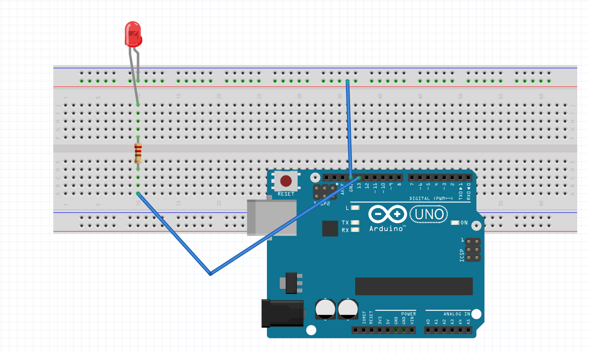
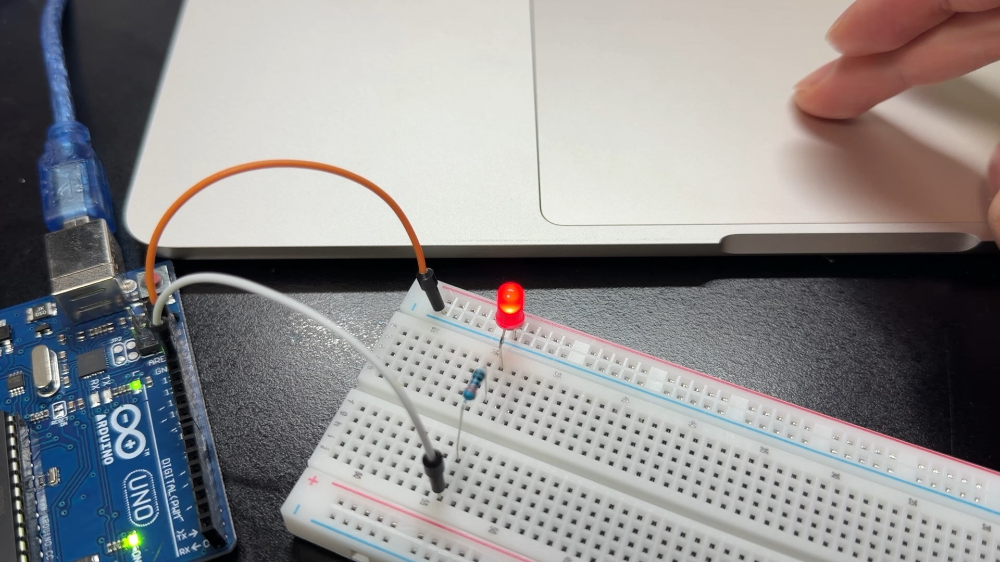

# p5 슬라이더를 이용하여 LED의 밝기 조절하기

고동현 · 2026-11-01

**[과제 제출용 웹 페이지](https://godongyen.github.io/p5-led-slider/)**

p5.js 슬라이더로 0~255 값을 보내고, Arduino Uno의 D13에 연결한 LED 밝기를 조절하는 프로젝트다.

## 연결도

- D13 → 220~330Ω 저항 → LED 긴 다리(+)
- LED 짧은 다리(−) → GND
- USB → 컴퓨터

## 시연

[웹 페이지에서 영상 보기](https://godongyen.github.io/p5-led-slider/#demo) · [MP4 다운로드](assets/demo.mp4)

## 코드

- [아두이노 코드](LedSlider/LedSlider.ino): Arduino IDE에 넣고 Uno에 업로드한다.
- [p5.js 코드](p5/sketch.js): p5 웹 에디터의 sketch.js에 붙여 넣는다.
- 추가 아두이노 라이브러리는 필요 없다.

## 실행 방법

1. 아두이노 코드를 업로드하고 시리얼 모니터·플로터를 닫는다.
2. Chrome 또는 Edge에서 https://editor.p5js.org/ 를 연다.
3. p5 코드를 붙여 넣고 실행한다.
4. 아두이노 연결 버튼을 눌러 Uno USB 포트를 선택한다.
5. 슬라이더를 움직인다. 0은 꺼짐, 255는 최대 밝기다.

## 동작 원리

p5가 50ms마다 밝기 값을 1바이트로 보낸다. Uno는 115200 baud로 수신하고 약 2040μs 주기의 소프트웨어 PWM으로 D13을 제어한다. D13은 하드웨어 PWM 핀이 아니므로 analogWrite를 사용하지 않는다. 2초 동안 데이터가 들어오지 않으면 LED를 끈다. 화면의 원은 밝기 미리보기이며 측정값은 아니다.

## 확인 결과

Uno 컴파일 및 업로드 성공. 프로그램 2,210바이트(6%), 전역 변수 193바이트(9%). 0, 64, 128, 192, 255, 0 전송 및 동일 값 응답 확인. 제공된 실물 영상과 영상에서 추출한 사진을 첨부했다.

## 고찰

처음에는 슬라이더가 움직여도 LED 밝기가 바뀌지 않았다. 화면에서 값이 바뀌는 것과 아두이노가 그 값을 받아서 출력하는 것은 별개이므로, USB 연결과 보드에 업로드한 코드를 함께 확인했다. D13은 하드웨어 PWM 핀이 아니어서 소프트웨어 PWM으로 구현했다. 이후 0, 64, 128, 192, 255 값을 보내고 같은 값이 돌아오는지 검사해 통신을 확인했다. 이번 실습을 통해 핀의 기능, 통신 속도, 전송 형식을 맞추는 것이 중요하다는 점을 확인했다. 더 일정한 PWM 파형이 필요하다면 하드웨어 PWM을 지원하는 핀을 사용하는 방법도 있다.
